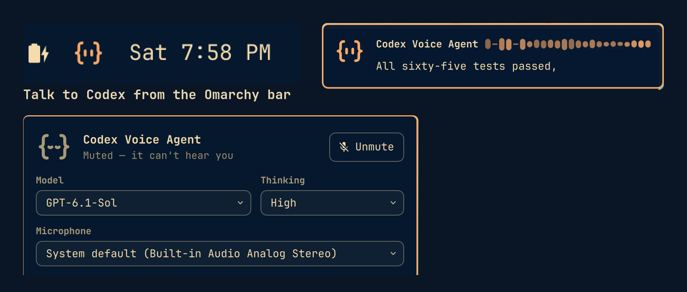
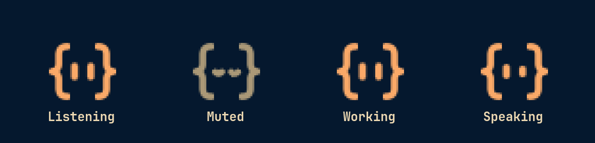
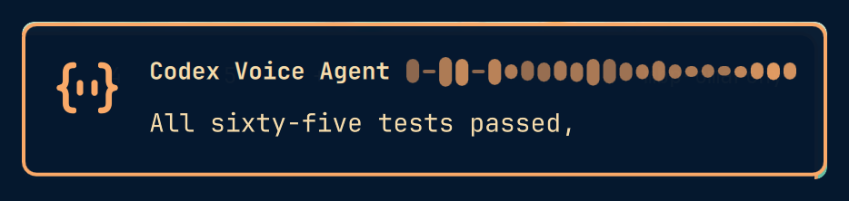
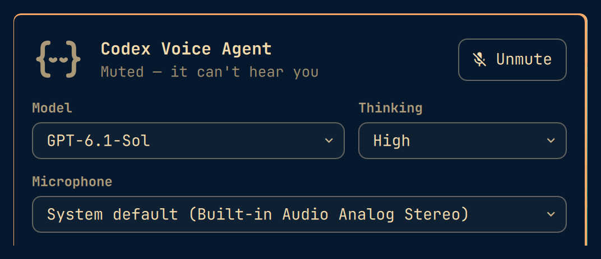

# Codex Voice Agent

Talk to [Codex](https://github.com/openai/codex) from the Omarchy bar. Codex Voice Agent keeps
a Codex session running in the background with a microphone you switch on and off. Speak a
request, and Codex does the work (reading files, running commands, answering questions) and
tells you the answer out loud. A small face in the bar always shows whether it is listening.



> **Unofficial.** This project is not made by, affiliated with, or endorsed by OpenAI or by
> Omarchy/37signals. "Codex" refers to OpenAI's Codex CLI, which you install and sign in to
> yourself.

> **Experimental.** Voice uses the Codex app-server's realtime API, which Codex marks as
> experimental. A Codex update can change it; if voice stops working after a Codex update,
> check for a newer release of this project.

## Features

- **Always-on session, starts muted.** It starts with your desktop session, muted, with no
  voice connection open. The first unmute connects in about a second.
- **Listening state at a glance.** The bar icon is a face made of code braces:

  | Icon | Meaning |
  |---|---|
  | `{• •}` in the accent colour, eyes open (the odd blink) | Listening |
  | Dimmed, eyes closed | Muted: it cannot hear you |
  | Grey, eyes closed | The backend is not running |
  | Eyes glance from side to side | Codex is working |
  | Eyes move with the voice | The agent is speaking |

  

- **Three ways to mute:** an optional global key, a right-click on the bar icon, or saying
  "mute yourself" / "stop listening" / "go to sleep". Each change shows an on-screen message.
- **Reply card.** While the agent answers, a small card in the top-right corner shows its
  words and a live visualizer of its voice. It stays hidden over fullscreen windows.

  
- **Panel** (left-click the icon): status, mute, **Model** and **Thinking** level, **Microphone**,
  the session history (what you said, what Codex ran, its answers, safety-review decisions),
  a box to type a request, **New session**, and **Open in terminal** (`codex resume` this
  session).

  
- **Echo cancellation** on the microphone, so the agent does not hear itself through your
  speakers (or a video playing in the background).

## Requirements

- **Omarchy 4** (the Quickshell-based `omarchy-shell` bar).
- **Codex CLI**, installed and signed in (`codex login`). Last tested with Codex **0.166.0**, signed
  in with a ChatGPT account. An API key is not needed.
- **uv** (fetches Python 3.13 for the backend), **jq**, **rsync**, and the **PipeWire** tools
  `pw-record`, `pw-play`, `pw-cli` and `pw-dump`. All are in the Arch repositories:
  `omarchy-pkg-add uv jq rsync pipewire` (Omarchy ships PipeWire already).
- A microphone and speakers or headphones.
- Tested on aarch64 Omarchy. x86_64 should work the same (the Python dependencies, `aiortc`,
  `numpy` and the pure-Python `markdown-it-py`, ship prebuilt wheels for both) but has not been
  tested yet.

## Install

### From the Omarchy plugin marketplace

```bash
omarchy plugin add https://github.com/mlamoure/codex-voice-agent.git --enable
~/.config/omarchy/plugins/mlamoure.codex-voice-agent/install.sh
```

`omarchy plugin add` only clones and enables the bar plugin; it never runs install steps. The
second command installs the backend service it needs (run from the plugins folder, the
installer sets up only the backend). Add `--key "SUPER + SHIFT + M"` to bind a mute key.

### From a clone

```bash
git clone https://github.com/mlamoure/codex-voice-agent.git
cd codex-voice-agent
./install.sh
```

The installer sets up the backend, copies the bar plugin into
`~/.config/omarchy/plugins/codex-voice-agent`, adds the widget to the right side of your bar
(before the clock), and starts the `codex-voice-agent` user service. It does **not** change
your keybindings unless you ask for a mute key:

```bash
./install.sh --key "SUPER + SHIFT + M"     # any Hyprland key spec, e.g. "XF86AudioMicMute" or "F5"
```

The binding goes into `~/.config/hypr/bindings.lua` inside a clearly marked block, which the
installer keeps on later runs and removes with `--key none` or `--uninstall`.

`./install.sh --backend-only` installs just the backend service, whatever folder it runs from.

### Uninstall

```bash
./install.sh --uninstall
```

This stops and removes the service, the widget, the key binding, the CLI link and the backend.
For a marketplace install, run it from `~/.config/omarchy/plugins/mlamoure.codex-voice-agent/`
and then `omarchy plugin remove mlamoure.codex-voice-agent`.
Your settings (`~/.config/codex-voice-agent`) and saved choices
(`~/.local/state/codex-voice-agent`) are kept; delete them by hand if you want.

## Using it

1. Unmute: your mute key, a right-click on the bar icon, or **Unmute** in the panel.
2. Talk. Ask anything you would ask Codex: "what branch is this repo on?", "find the TODOs in
   the backend and summarize them", "is my disk getting full?". Short questions are answered
   directly; anything that needs work is handed to Codex, which runs it and reports back.
3. Mute again when you are done. While muted the agent hears nothing, but a task already
   running carries on and it can still speak the result.

If the voice connection drops (network trouble, the microphone disappearing), the agent mutes
itself and shows "Voice assistant disconnected", so the face never claims to listen when
nothing is. Unmute to reconnect.

**Typing instead of talking:** use the box at the bottom of the panel, or
`codex-voice-agent send "your request"`. Typed requests go straight to Codex.

**Choosing a microphone:** the panel's **Microphone** list starts with *System default (…)*,
which follows whatever input your system uses. Pick another device to override it; the choice
is remembered and applied immediately.

**Model and thinking level** apply from the next request, including spoken ones, and are
remembered.

**Sessions:** every start of the service begins a new Codex session in your working directory.
Old sessions remain available with `codex resume`.

## Safety and privacy

- **What Codex may do.** Sessions use Codex's workspace sandbox (`workspace-write`): normal
  work inside the working directory runs without asking. Anything outside it (other folders,
  system commands) goes to Codex's **auto-review**, an AI reviewer that judges the risk and
  approves or denies it. Denials show in the panel with **Approve anyway**. Your own
  `~/.codex/config.toml` is not changed. To give the agent full access instead, set
  `permissions = "full"` (see Configuration); think twice, since it acts on spoken words.
- **Where your audio goes.** While unmuted, your microphone audio streams to OpenAI's realtime
  service through Codex, and the agent's replies stream back. Audio is never saved to disk;
  the text of requests that reach Codex is kept in its session history under `~/.codex`, as
  for any Codex session. While muted only silence is sent. The microphone itself stays open locally for 15 minutes
  after you mute (so unmuting is instant) and is then closed until the next unmute.
- **Nothing in Codex's answers is loaded automatically.** What Codex reads can steer what it
  writes, so the reply card shows answers as plain text, and the panel shows Codex's Markdown
  only after the backend has rendered it with every image replaced by its description and raw
  HTML shown as text. Links open only when you click them, and only `http(s)` links.
- **The bar plugin runs unsandboxed** inside `omarchy-shell`, like every Omarchy plugin. Read
  the code before installing it.

## Configuration

Optional. Create `~/.config/codex-voice-agent/config.toml`, then
`systemctl --user restart codex-voice-agent`:

```toml
workdir = "~/projects"               # where Codex works (default: your home directory)
permissions = "auto"                 # "auto" (sandbox + auto-review) or "full" (no sandbox, never asks)
extra_writable_roots = ["/tmp"]      # extra folders writable without review in "auto"
idle_voice_minutes = 15              # close the voice connection after this long muted (0 = never)
echo_cancel = true                   # cancel the speakers' sound out of the microphone
voice = "marin"                      # a realtime voice name (default: Codex's)
osd = true                           # on-screen messages when muting and unmuting
voice_mute_command = true            # "mute yourself" / "stop listening" mutes the agent
codex_command = ["codex"]            # how to run Codex, if it is not on the service's PATH
```

## Command line

```
codex-voice-agent mute [toggle|on|off]    what the mute key runs
codex-voice-agent state                   current state as JSON
codex-voice-agent history                 this session's history as JSON
codex-voice-agent send "text"             type a request to Codex
codex-voice-agent new-session             start a fresh Codex session
codex-voice-agent watch                   print live events (debugging)
codex-voice-agent daemon [-v]             the service itself
```

## Troubleshooting

| Symptom | What to check |
|---|---|
| Grey icon / "not running" | `systemctl --user status codex-voice-agent`, then `journalctl --user -u codex-voice-agent -e` |
| "Codex unavailable" in the panel | The service runs with its own PATH: `~/.local/share/mise/shims`, `~/.local/bin`, `/usr/share/omarchy/bin`, `/usr/local/bin`, `/usr/bin`. If `codex` lives elsewhere (`command -v codex`), set `codex_command = ["/full/path/to/codex"]`. Is it signed in? `codex login status` |
| "Voice could not start" / it mutes itself right away | The panel history has the reason. Usually the microphone (pick another in the panel) or a Codex version with a changed realtime API |
| A warning about config.toml in the panel | A setting has a typo or the wrong type; that setting falls back to its default until fixed |
| It does not hear you | Is it unmuted (accent face)? Is the right microphone selected? Test the device with `pw-record --target <device> test.wav` |
| It hears itself / talks over itself | Make sure `echo_cancel` is on; use headphones in a very echoey room |
| Widget missing after install | `omarchy plugin enable <plugin-id> --section right`; QML errors are in `journalctl --user -t omarchy-shell` |

Run the backend in the foreground with debug logs: `systemctl --user stop codex-voice-agent`,
then `codex-voice-agent daemon -v`.

## How it works

```
omarchy-shell plugin (QML)             backend: codex-voice-agent (Python)             codex app-server (child)
  Service.qml ─ Unix socket ──────────►  session, mute, history, control socket ─ JSONL ─►  thread, turns, auto-review
  Widget.qml, ReplyCard.qml              voice link: WebRTC peer (aiortc) ◄── SDP ────►  realtime v3 session
                                         mic: pw-record (+ echo canceller)                  └─ hands spoken requests
                                         speaker: pw-play through a jitter buffer              to Codex turns
```

- The backend starts its own `codex app-server` and talks JSON-RPC to it over stdio.
- Voice uses the app-server's documented WebRTC transport with the backend's own peer
  connection and realtime protocol v3, which works with a ChatGPT sign-in.
- PipeWire's echo canceller runs in monitor mode: it uses what your speakers play as its
  reference and is never placed in the playback path.
- The plugin keeps no state of its own; it renders what the backend reports over
  `$XDG_RUNTIME_DIR/codex-voice-agent.sock`.

## Development

```bash
uv venv .venv && uv pip install --python .venv/bin/python -e '.[dev]'
.venv/bin/python -m pytest              # a fake codex drives the daemon; node is needed for the plugin-logic tests
.venv/bin/python -m pyflakes src tests
```

The repository root is the plugin (`manifest.json` and the QML files); the Python backend lives
in `src/`. The test suite stages the plugin files the way `install.sh` does and runs
`omarchy plugin validate` on them (validating the checkout itself fails once it holds a
`.venv`, since plugin folders may not contain symlinks).

## Versions

Releases use date versions, `YEAR.MONTH.DAY` (for example `2026.10.31`), which sort and
compare like semantic versions.

## License

[MIT](LICENSE)
